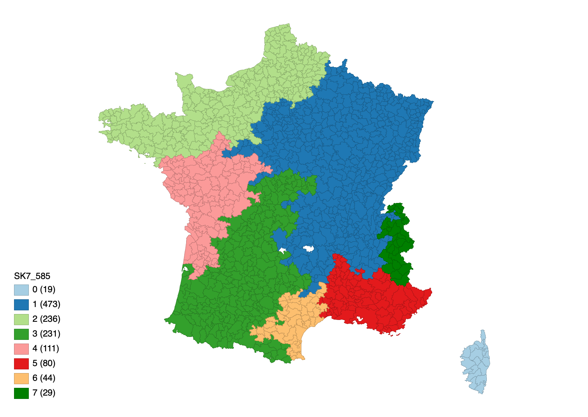
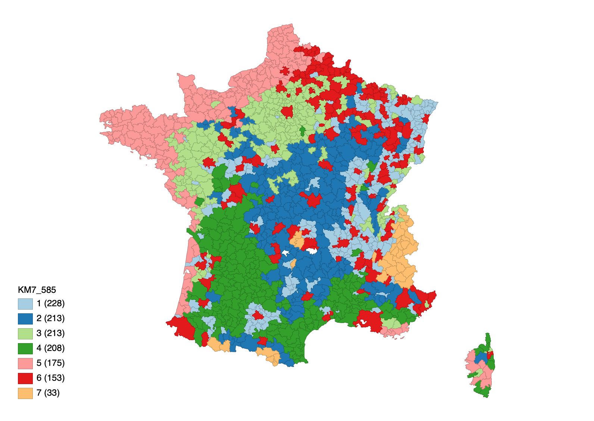

# Vulnérabilité des personnes âgées aux températures extrêmes
 
Typologie des 1 223 intercommunalités (EPCI) de France métropolitaine sous les scénarios climatiques 2081-2100, par apprentissage non supervisé.
 
Projet individuel réalisé par **Lilou Parrin** (ESIEE Paris, E4 Data Science & IA), cours « IA et changement climatique », octobre 2026.
 
 **[Lire le rapport complet (PDF)](rapport/Rapport_PARRIN_Lilou.pdf)**
 

 
---
 
## Contexte
 
Lors de la canicule d'août 2003, la France a enregistré environ 15 000 décès supplémentaires en quelques semaines, en très grande majorité des personnes de plus de 75 ans, souvent isolées. Les grands froids présentent des risques comparables, en particulier pour les personnes qui n'ont pas les moyens de bien chauffer leur logement.
 
Ces risques vont augmenter : la trajectoire retenue par l'État pour l'adaptation au changement climatique (TRACC) prévoit un réchauffement de 4 °C en France hexagonale d'ici 2100, et les 75 ans et plus représentent déjà près de 10 % de la population, une part appelée à croître.
 
Mais tous les territoires ne sont pas menacés de la même façon : un territoire très chaud mais jeune et bien doté en médecins n'est pas vulnérable comme un territoire tempéré mais âgé, isolé et éloigné des soins.
 
## Objectif
 
Regrouper les intercommunalités françaises en **5 à 10 zones homogènes** selon leur profil de vulnérabilité, afin que chaque zone puisse être confiée à un groupe d'experts chargé de préparer son adaptation.
 
## Question
 
Quels profils de vulnérabilité des personnes de 75 ans et plus aux températures extrêmes distinguent les EPCI de France métropolitaine à l'horizon 2081-2100 ?
 
La vulnérabilité combine trois dimensions : l'**exposition** au climat (chaleur estivale et froid hivernal), la **sensibilité** de la population (part des 75 ans et plus, isolement) et sa **capacité d'adaptation** (pauvreté, accès aux médecins).
 
## Données
 
| Dimension | Indicateur | Source |
|---|---|---|
| Sensibilité | Part des 75 ans et plus (%) | Insee, recensement 2022 |
| Sensibilité | Part des 75 ans et plus vivant seuls (%) | Insee, recensement 2022 |
| Adaptation | Taux de pauvreté (%) | Insee, Filosofi 2021 |
| Adaptation | Accessibilité aux médecins généralistes (APL) | DREES, 2023 |
| Exposition | Température max. du mois le plus chaud, 2081-2100 (°C) | WorldClim 2.1, modèle IPSL-CM6A-LR |
| Exposition | Hausse de cette température par rapport à 1970-2000 (°C) | Calculé |
| Exposition | Température min. du mois le plus froid, 2081-2100 (°C) | WorldClim 2.1, modèle IPSL-CM6A-LR |
 
Deux scénarios climatiques sont comparés : **SSP2-4.5** (intermédiaire) et **SSP5-8.5** (pessimiste).
 
## Méthode
 
1. **Indicateurs climatiques** : moyenne des pixels WorldClim à l'intérieur de chaque EPCI (statistiques zonales, `scripts/calcul_climat_epci.py`).
2. **Préparation** : jointure des sources, traitement des valeurs manquantes (secret statistique) et des valeurs atypiques, standardisation.
3. **Clustering** sous GeoDa :
   - **k-moyennes** (7 groupes) pour chaque scénario, sans contrainte géographique ;
   - **SKATER** pour obtenir des zones géographiquement continues, confiables à des groupes d'experts.
4. **Comparaison** des groupes entre les deux scénarios (stabilité des profils), analyses et graphiques en Python.

 
## Principaux résultats
 
- Les territoires les plus exposés à la chaleur ne sont pas forcément les plus fragiles socialement : la vulnérabilité ne se réduit pas à l'exposition.
- Deux groupes cumulent toutes les fragilités : un groupe « rural âgé, pauvre et sous-médicalisé » au centre de la France, et un groupe « sud chaud, âgé et pauvre » qui s'étend au Sud-Ouest intérieur dans le scénario pessimiste.
- Les grandes agglomérations présentent une vulnérabilité liée à l'isolement des personnes âgées.
- 71,4 % des EPCI restent dans un groupe équivalent d'un scénario à l'autre ; l'approche par zones continues (SKATER) aboutit à huit zones d'adaptation.
## Contenu du dépôt
 
```
├── rapport/Rapport_PARRIN_Lilou.pdf   # rapport complet (37 pages)
├── scripts/calcul_climat_epci.py      # calcul des indicateurs climatiques par EPCI
├── geoda/                             # projet GeoDa : données jointes (Parquet), matrice de voisinage, projet
├── images/                            # cartes des résultats
└── requirements.txt
```
 
## Reproduire le calcul climatique
 
Les données brutes (rasters WorldClim, contours des EPCI) ne sont pas versionnées car trop volumineuses. Pour relancer le script :
 
1. Télécharger sur [WorldClim](https://www.worldclim.org/) les variables bioclimatiques 1970-2000 (BIO5, BIO6) et les projections 2081-2100 du modèle IPSL-CM6A-LR (SSP2-4.5 et SSP5-8.5).
2. Les placer dans un dossier `data/` à la racine, avec le shapefile des EPCI (`data/EPCI/EPCI.shp`), en suivant les noms de fichiers indiqués en haut du script.
3. Lancer :
```bash
pip install -r requirements.txt
python scripts/calcul_climat_epci.py
```
 
Le projet GeoDa (`geoda/projet_geoda.gda`) s'ouvre directement dans [GeoDa](https://geodacenter.github.io/).
 
## Outils
 
Python (pandas, geopandas, rasterstats) · GeoDa · k-moyennes · SKATER · analyse de données spatiales
 
